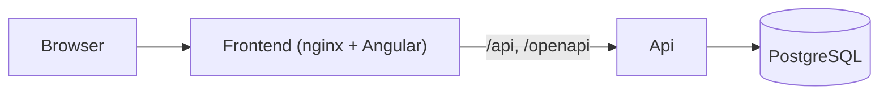
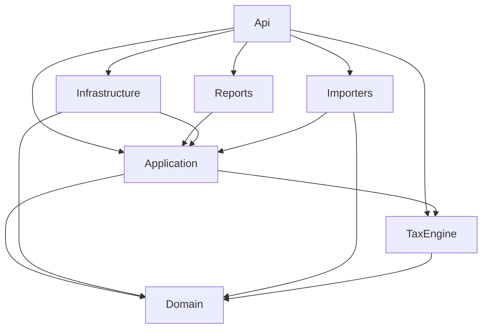

# 02 – Architektur

Stand: P1 (Projektgerüst). Fachlogik, Datenmodell und Importe folgen in den nächsten Prompts.

## Überblick

Ein **modularer Monolith**: ein .NET-Backend, eine Angular-Oberfläche und PostgreSQL, alles per
Docker Compose. Die Steuerlogik liegt in einem eigenen Projekt ohne Datenbank, damit sie isoliert
und reproduzierbar testbar ist (siehe [ADR 0001](adr/0001-modularer-monolith.md)).



## Repository

```text
krypto-steuer/
├─ CLAUDE.md, README.md, CHANGELOG.md
├─ Directory.Build.props        gemeinsame Build-Einstellungen (net10.0, Nullable, Warnungen als Fehler)
├─ docker-compose.yml
├─ docs/                        dieses Handbuch, adr/
├─ src/backend/                 KryptoSteuer.sln, Dockerfile
│  ├─ Domain/                   reine Fachlogik, keine Abhängigkeiten
│  ├─ Application/              Use Cases und Ports (Interfaces)
│  ├─ Infrastructure/           EF Core, PostgreSQL, spätere HTTP-Clients
│  ├─ Importers/                später ein Ordner je Quelle
│  ├─ TaxEngine/                Steuer-Engine, nur von Domain abhängig
│  ├─ Reports/                  PDF- und Excel-Berichte (QuestPDF, ClosedXML), hängt von Application ab
│  └─ Api/                      ASP.NET Core Web API, OpenAPI
├─ src/frontend/                Angular-App, Dockerfile, nginx.conf
└─ tests/                       Domain.Tests, TaxEngine.Tests, Importers.Tests, Api.IntegrationTests
```

## Abhängigkeiten der Backend-Projekte



Regeln, die Architekturtests absichern:

- `Domain` verweist auf kein anderes Projekt.
- `TaxEngine` verweist nur auf `Domain`.
- `Importers` kennt weder `Infrastructure` noch `Api` noch `TaxEngine`.
- `Reports` kennt weder `Infrastructure` noch `Api`.

## Health-Endpunkt als Referenz-Schnitt

`GET /api/health` zeigt den Aufbau einmal von oben nach unten:

1. `Api` (`Program.cs`) nimmt die Anfrage entgegen und ruft den Use Case.
2. `Application` (`GetHealthUseCase`) fragt über den Port `IDatabaseProbe`.
3. `Infrastructure` (`NpgsqlDatabaseProbe`) prüft die Verbindung über EF Core (Timeout 3 s).

Antwort `200` mit `{ "status": "Healthy", "database": "Up", ... }`, bei fehlender Datenbank `503`
mit `Unhealthy`/`Down`. Docker-Healthchecks nutzen den Statuscode.

Der Connection-String kommt aus `ConnectionStrings:Postgres` (Umgebungsvariable
`ConnectionStrings__Postgres`) und wird erst beim ersten Datenbankzugriff gelesen. Er steht nie im Log.

## Frontend

Angular mit Standalone Components, Signals, Angular Material (Material 3, Dark Mode folgt dem
System), Routing und deutscher Locale (`sourceLocale: de`). Die Startseite (`HealthPage`) ruft
`/api/health` auf. Im Container leitet nginx `/api/` und `/openapi/` an den `api`-Dienst weiter;
in der Entwicklung übernimmt das `proxy.conf.json`.

## Docker Compose

| Dienst | Image | Port (nur 127.0.0.1) | Healthcheck |
|---|---|---|---|
| `postgres` | `postgres:17-alpine` | 5432 | `pg_isready` |
| `api` | eigenes Image (.NET 10) | 5080 → 8080 | `curl /api/health` |
| `frontend` | nginx mit Angular-Build | 4200 → 80 | `wget /` |
| `pgadmin` (Profil `tools`) | `dpage/pgadmin4` | 5050 → 80 | `wget /misc/ping` |

Startreihenfolge: `postgres` gesund → `api` gesund → `frontend`.

## Offene Punkte aus P1

- Der Angular-Client wird noch nicht aus der OpenAPI-Spezifikation generiert, sondern ist für den
  Health-Aufruf von Hand geschrieben (Anleitung in der README).
- CI, Coverage und Sicherheits-Scans: siehe [07-betrieb.md](07-betrieb.md) (P3).
- Docker-Image-Builds (`docker compose up --build`) sind noch nicht in einer Umgebung mit Internet im Container geprüft; Backend und Frontend wurden direkt gebaut und getestet.
