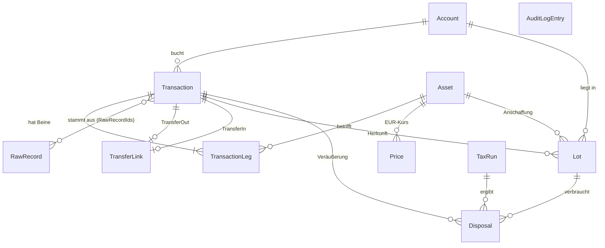

# 03 – Datenmodell

Stand: P2. Das Ledger ist unveränderlich und nachvollziehbar: Rohdaten bleiben unangetastet,
Korrekturen sind eigene Overrides mit Audit-Log (siehe [ADR 0002](adr/0002-rohdaten-unveraenderlich.md)).

Code: `src/backend/Domain/Ledger` (Entitäten, Invarianten), `src/backend/Infrastructure/Persistence`
(EF-Core-Konfiguration).

## Entitäten

| Entität | Zweck |
|---|---|
| `Account` | Wallet, Börsenkonto oder Depot (Name, Typ, Plattform, Land, Teilkonto) |
| `Asset` | Symbol, Klasse, ISIN, Contract/Chain, `IsTauschkryptowert` (Reform), `IsWrappedOf` |
| `RawRecord` | unveränderte Rohzeile/Roh-JSON, Quelle, Datei-Hash (SHA-256), Importlauf, Zeitstempel |
| `Transaction` | normalisierte Buchung mit Typ, Zeitpunkt UTC, Konto, Beinen, Verweisen auf Rohdaten, Status |
| `TransactionLeg` | Asset, Menge (immer > 0), Richtung In/Out, Gebührenflag |
| `TransferLink` | verbindet `TransferOut` und `TransferIn` eigener Konten (steuerneutral) |
| `Price` | EUR-Kurs je Asset und Zeitpunkt mit Quelle |
| `Lot` | Anschaffungslos (von der Engine befüllt): Restmenge, Kosten, Regime Alt/Neu |
| `Disposal` | Veräußerung je verbrauchtem Lot: Erlös, AK, Gebührenanteil, Gewinn, Haltetage, steuerpflichtig, Regelsatz-Version |
| `TaxRun` | Berechnungslauf: Parameter, Regelsatz, Hash der Eingabedaten, Ergebnis-Snapshot |
| `AuditLogEntry` | manuelle Änderung mit Vorher/Nachher und Begründung |

## Regeln

- Mengen `decimal(38,18)`, EUR-Beträge `decimal(28,8)`; Rundung erst im Report.
- Zeitstempel sind UTC (`Offset = 0`); `Transaction.Validate()` prüft das.
- **Idempotenz:** `(Quelle, externe ID)` ist eindeutig; ohne externe ID gilt der Hash des Rohinhalts
  (`IdempotencyKey`). Die Datenbank erzwingt das über partielle Unique-Indizes.
- **Rohdaten sind unveränderlich:** `AppDbContext` verweigert Ändern und Löschen von `RawRecord`
  beim Speichern.
- Fehlende Daten (Kurs, Kostenbasis) werden nicht als 0 angenommen, sondern: `Status = NeedsReview`.

## Invarianten der Beine (`Transaction.Validate`)

| Typ | Beine (ohne Gebühr) |
|---|---|
| Buy, Sell, Trade | genau 1 In und 1 Out |
| Deposit, TransferIn, Staking, Lending, Airdrop, Mining, Bonus, Interest, Dividend, GiftIn | genau 1 In |
| Withdrawal, TransferOut, Fee, Spend, GiftOut | genau 1 Out |
| FuturesPnL, FundingFee, Liquidation | genau 1 Bein (Gewinn = In, Verlust = Out) |

Zusätzlich: Menge > 0, höchstens ein Gebührenbein, Gebührenbeine sind ausgehend.

## Migrationen

Die erste Migration wird mit `dotnet ef migrations add Initial -p src/backend/Infrastructure -s src/backend/Api`
erzeugt (Tool: `dotnet tool install --global dotnet-ef`). Sie ist noch nicht eingecheckt, weil das Modell
in einer Umgebung ohne .NET-SDK entstand.
