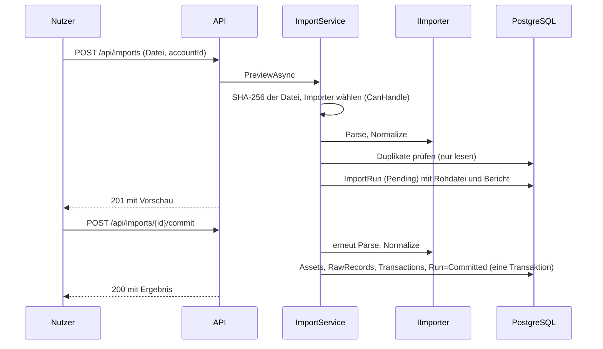

# 04 – Importe

Stand: P6 (Bitget-CSV, Futures). Es gibt das allgemeine CSV-Format `generic-csv` als Referenz, den Bitget-API-Connector
(`bitget-api`) und den Bitget-CSV-Import für Futures (`bitget-csv`). CSV für Bitget-Spot, Ein-/Auszahlungen und Earn sowie Trade Republic (P7) folgen.

Code: `Application/Imports` (Schnittstelle, Ablauf, Ports), `Importers/` (ein Ordner je Quelle, `Common/` für
gemeinsame Bausteine), `Infrastructure/Persistence/EfImportStore.cs`, `Api/Endpoints/ImportEndpoints.cs`.

## Ablauf eines Importlaufs



1. **Roh speichern:** Die Datei wird unverändert im `ImportRun` abgelegt (SHA-256). Vorschau schreibt sonst nichts.
2. **Parsen und normalisieren:** `Parse` liefert `RawRecord`s, `Normalize` daraus `Transaction`s. Neue Assets
   werden nur im Speicher angelegt (`AssetCatalog`) und erst beim Festschreiben gespeichert.
3. **Duplikate verwerfen:** über `(Quelle, externe ID)`, ohne externe ID über den Inhalts-Hash der Zeile. Auch
   doppelte Zeilen innerhalb einer Datei zählen als Duplikat. Die Datenbank sichert das zusätzlich über Unique-Indizes ab.
4. **Vorschau:** Der Importbericht zeigt, was passieren würde.
5. **Bestätigen:** Beim Commit wird neu analysiert (andere Läufe könnten dazwischen festgeschrieben haben) und
   dann in einer Transaktion geschrieben.
6. **Löschen:** nur unbestätigte Läufe. Bestätigte Läufe und ihre Rohdaten bleiben ([ADR 0002](adr/0002-rohdaten-unveraenderlich.md)).

## Importbericht

| Feld | Bedeutung |
|---|---|
| `rowsRead` | gelesene Datenzeilen (ohne Kopfzeile) |
| `new` | neue Buchungen |
| `duplicates` | bereits importierte oder doppelte Zeilen |
| `needsReview` | Buchungen mit Status `NeedsReview` |
| `errors` | `lineNumber` und `reason` je fehlerhafter Zeile; diese Zeilen werden nicht geschrieben |
| `unknownTypes` | unbekannte Transaktionstypen der Quelle |
| `warnings` | Hinweise ohne Abbruch: abgeleitete Zeitzone, Lücken im Kontostand, Buchungen, die schon aus einer anderen Quelle vorliegen |

**Unbekannte Typen werden nie stillschweigend verworfen:** Sie werden als `Transaction` mit
`Type = Unknown`, `Status = NeedsReview` und Hinweis im `Note` gespeichert und landen in der Review-Queue.

## API

| Endpunkt | Zweck |
|---|---|
| `POST /api/accounts`, `GET /api/accounts` | Konten anlegen/auflisten (Importe brauchen ein Konto) |
| `POST /api/imports` | Multipart: `file`, `accountId`, optional `source`, optional `timeZone` (Zeitzone der Datei, z. B. `+02:00`); liefert die Vorschau (201) |
| `GET /api/imports/{id}` | Bericht eines Laufs |
| `POST /api/imports/{id}/commit` | festschreiben (409, wenn schon bestätigt) |
| `DELETE /api/imports/{id}` | nur unbestätigte Läufe (409 sonst, 204 bei Erfolg) |

Fehler: 400 (leere/unbekannte Datei, unbekannte Quelle), 404 (Lauf oder Konto fehlt), 409 (Zustand passt nicht).
Das Upload-Limit ist das Kestrel-Standardlimit (ca. 30 MB).

## Format `generic-csv`

```csv
id,timestamp,type,asset,amount,counter_asset,counter_amount,fee_asset,fee
t-2,2026-01-11T10:00:00+01:00,buy,BTC,0.05,EUR,2500,EUR,2.5
```

- Komma oder Semikolon (aus der Kopfzeile erkannt), Anführungszeichen nach RFC 4180, UTF-8 mit/ohne BOM.
- `timestamp`: ISO 8601; ohne Zeitzone gilt UTC, mit Offset wird nach UTC umgerechnet.
- Zahlen mit Punkt als Dezimaltrenner. `id` ist optional (ohne `id` gilt der Inhalts-Hash der Zeile).
- `type`: Name aus `TransactionType` (Groß-/Kleinschreibung egal, Unterstriche erlaubt, z. B. `transfer_out`).
- Buy, Sell, Trade: `asset/amount` = Erhaltenes, `counter_asset/counter_amount` = Gegebenes.
- Futures-Typen: Vorzeichen von `amount` bestimmt die Richtung (Gewinn = In, Verlust = Out).
- Gebühr: `fee` und `fee_asset` (immer ausgehend).

Beispieldateien: `tests/fixtures/generic-csv/`.

## Wie füge ich einen neuen Broker hinzu?

1. **Fixture anlegen:** echte (anonymisierte) Beispieldatei unter `tests/fixtures/<quelle>/`, auch mit Sonderfällen
   (unbekannter Typ, kaputte Zeile, Duplikat).
2. **Tests zuerst:** in `tests/Importers.Tests` ein Test, der die Datei über `ImportService` mit `InMemoryImportStore`
   einliest und erwartete Buchungen, Fehlerzeilen und `NeedsReview`-Fälle prüft.
3. **Importer schreiben:** Ordner `src/backend/Importers/<Quelle>/` mit einer Klasse, die `IImporter` implementiert:
   - `Source`: eindeutiger Name (z. B. `bitget-csv`).
   - `CanHandle`: erkennt die Datei an Kopfzeile/Struktur, ohne Seiteneffekte.
   - `Parse`: liefert je Datenzeile ein `RawRecord` mit `Payload` (Originaltext), `ContentHash`
     (`IdempotencyKey.Sha256Hex(payload)`), `ExternalId` (falls die Quelle eine liefert), `LineNumber`,
     `FileHash`, `ImportRunId`, `ImportedAtUtc` aus dem `ImportContext`. Unlesbare Zeilen mit
     `context.AddError(zeile, grund)` melden, `context.RowsRead` hochzählen.
   - `Normalize`: baut aus dem `RawRecord` die `Transaction`(s). Assets über `context.Assets.Resolve(symbol)`.
     Jede Buchung muss `Transaction.Validate()` bestehen (siehe [03-datenmodell.md](03-datenmodell.md)).
     Nicht normalisierbar: `ImportRowException` mit lesbarem Grund. Unbekannter Typ: `Type = Unknown`,
     `Status = NeedsReview`, `context.AddUnknownType(name)`.
   - Hat die Quelle mehrere Buchungen je Zeile, müssen `ExternalId`/`ContentHash` je Buchung eindeutig sein.
4. **Registrieren:** eine Zeile in `ImportersAssembly.AddImporters` (`services.AddSingleton<IImporter, ...>()`).
5. **Zeitstempel in UTC**, Mengen als `decimal`, Rundung erst im Report; Fehlendes (Kurs, Kosten) nie als 0 annehmen.
6. `docs/04-importe.md` (Format der Quelle) und `CHANGELOG.md` ergänzen.

Die Abhängigkeitsregeln prüft der Architekturtest: `Importers` kennt weder `Infrastructure` noch `Api` noch `TaxEngine`.

## Bitget-API (P5)

Code: `Importers/Bitget` (Signatur, HTTP-Client, Abruf, Importer, Salden, Sync-Dienst), `Api/Bitget` (Client-Fabrik, Tagesjob),
`Infrastructure/Persistence/EfBitgetSyncStore.cs`, `Api/Endpoints/BitgetEndpoints.cs`.

### Geprüfte Endpunkte (Stand 20.10.2026)

> **Wichtig zur Prüfung:** Die Bitget-Dokumentation (`bitget.com/api-doc`) war in der Entwicklungsumgebung nicht erreichbar.
> Die Endpunkte, Parameter und Antwortfelder stammen aus dem typisierten, öffentlich gepflegten npm-Paket
> [`bitget-api`](https://www.npmjs.com/package/bitget-api) 3.2.6 (Signatur und Header aus dessen Quelltext, V2 und V3).
> Das ist eine Sekundärquelle. **Bitte vor dem produktiven Einsatz gegen die offizielle Doku gegenprüfen**; insbesondere die
> Annahmen weiter unten.

Bitget kennt zwei Kontotypen mit unterschiedlichen Endpunkten. Die App erkennt den Typ selbst: Antworten
`/api/v3/account/info` **und** `/api/v3/account/settings`, ist es ein **UTA** (Unified Trading Account, V3); sonst ein
**klassisches Konto** (V2), geprüft über `/api/v2/spot/account/info`.

| Zweck | Klassisch (V2) | UTA (V3) |
|---|---|---|
| Serverzeit | `/api/v2/public/time` | (V2-Endpunkt wird mitgenutzt) |
| Rechte/Kontotyp | `/api/v2/spot/account/info` (`authorities`) | `/api/v3/account/info` (`permissions`, `permType`), `/api/v3/account/settings` |
| Symbole (Basis-/Quote-Coin) | `/api/v2/spot/public/symbols` | `/api/v3/market/instruments?category=SPOT` |
| Spot-Fills | `/api/v2/spot/trade/history-orders` (Symbole finden), `/api/v2/spot/trade/fills` (je Symbol) | `/api/v3/trade/fills?category=SPOT` |
| Konto-Buchungen (Bills) | `/api/v2/spot/account/bills` | – |
| Ein-/Auszahlungen | `/api/v2/spot/wallet/deposit-records`, `.../withdrawal-records` | `/api/v3/account/deposit-records`, `.../withdrawal-records` |
| Futures: Gewinn, Funding, Gebühren | `/api/v2/mix/account/bill` je `USDT-FUTURES`, `COIN-FUTURES`, `USDC-FUTURES` | `/api/v3/account/financial-records` je Kategorie |
| Convert | `/api/v2/convert/convert-record` | `/api/v3/account/convert-records` |
| Earn (Savings) | `/api/v2/earn/savings/records` (`flexible`, `fixed`) | – |
| Salden (Abgleich) | `/api/v2/spot/account/assets`, `/api/v2/mix/account/accounts`, `/api/v2/earn/account/assets`, `/api/v2/account/funding-assets` | `/api/v3/account/assets`, `/api/v3/account/funding-assets` |

### Authentifizierung

Header `ACCESS-KEY`, `ACCESS-SIGN`, `ACCESS-TIMESTAMP` (Millisekunden), `ACCESS-PASSPHRASE`.
`ACCESS-SIGN = Base64(HMAC-SHA256(secret, timestamp + METHOD + requestPath + "?" + query + body))`.
Die Zeit wird einmal je Client über den Server-Time-Endpunkt abgeglichen. Die App sendet nur GET-Aufrufe.
`BitgetSigner` ist gegen unabhängig berechnete Testwerte geprüft.

### Rechte des Keys

Der Key soll **nur Leserechte** haben. Beim Hinterlegen (`PUT /api/accounts/{id}/bitget`) prüft die App die Rechte und
warnt, wenn Handels-, Auszahlungs- oder Transferrechte aktiv sind (Treffer auf `trade`, `withdraw`, `transfer`, `write`).
Der Key wird dann trotzdem gespeichert; die Warnung steht in der Antwort und im Status (`GET .../bitget`).
Von Bitget abgelehnte Keys werden nicht gespeichert.

### Anleitung: Bitget-API-Key mit Leserechten anlegen

> Die Menüführung ändert sich gelegentlich; sie wurde nicht gegen die aktuelle Oberfläche geprüft.

1. In Bitget einloggen, oben rechts auf das Profil klicken und **API-Schlüssel** (API Keys) öffnen.
2. **API-Schlüssel erstellen** wählen, Typ **System-generiert** (System-generated API Key).
3. **Notiz** vergeben (z. B. „Krypto-Steuer lesen") und eine **Passphrase** festlegen (merken, wird später gebraucht).
4. Berechtigungen: **nur „Nur lesen“ (Read-only)**. Handel, Abhebung, Transfer **nicht** aktivieren.
5. **IP-Whitelist** empfohlen: nur die öffentliche IP des Servers eintragen, auf dem die App läuft.
6. Sicherheitsverifizierung abschließen. **Secret Key sofort kopieren**, er wird nur einmal angezeigt.
7. In der App: `PUT /api/accounts/{kontoId}/bitget` mit `{ "apiKey": "...", "secret": "...", "passphrase": "..." }`.
   Die App meldet Kontotyp und Warnungen. Key, Secret und Passphrase liegen nur verschlüsselt in der Datenbank
   (Schlüsselring außerhalb, siehe [07-betrieb.md](07-betrieb.md)).

### Zeitfenster, Pagination, Rate-Limits

- **Historie nur 90 Tage**, **je Abfrage höchstens 30 Tage**: Der Abruf zerlegt den Zeitraum in 30-Tage-Blöcke (`BitgetWindows`)
  und begrenzt ältere Startzeitpunkte auf 90 Tage. Ältere Daten kommen über den CSV-Import (P6).
- **Cursor-Pagination** mit `limit=100`: V2 über `idLessThan` (ID des letzten Eintrags bzw. `endId`), V3 über `cursor`.
  Gibt ein Endpunkt weder Cursor noch ID her, wird das Zeitfenster halbiert, bis keine Seite mehr voll ist.
- **Rate-Limits:** Bei HTTP 429 und 5xx wiederholt der Client bis zu 5-mal mit exponentiellem Backoff (1 s, 2 s, 4 s, 8 s);
  ein `Retry-After`-Header wird beachtet.

### Inkrementeller Sync

- Je Konto und Endpunkt (Abschnittsart) wird der letzte erfolgreiche Zeitpunkt gespeichert (`SyncState`).
- Der nächste Abruf beginnt beim ältesten dieser Zeitpunkte minus **7 Tage Überlappung** (späte Buchungen, zuvor ausstehende
  Ein-/Auszahlungen); Duplikate fängt die Idempotenz des Import-Frameworks ab.
- Fällt ein Endpunkt aus (z. B. Earn nicht freigeschaltet), läuft der Sync für die anderen weiter. Der Ausfall steht im Ergebnis
  (`failedSections`); der Zeitpunkt dieses Endpunkts wird nicht vorgezogen, der nächste Sync holt wieder 90 Tage.
- **Hintergrundjob:** täglich um 03:30 UTC (`BitgetDailySyncService`, ein Hosted Service statt Hangfire/Quartz, weil ein
  einziger täglicher Lauf für eine Person reicht). Abschaltbar mit `Bitget:DailySync:Enabled=false`.
- **Manuell:** `POST /api/accounts/{kontoId}/bitget/sync` („Jetzt synchronisieren“). Eine Schaltfläche in der Oberfläche
  gibt es noch nicht; die API ist fertig.

### Rohdaten

Der Abruf erzeugt ein JSON-Bündel (`bitget-api-bundle/1`) der rohen Antworten und schickt es durch das normale
Import-Framework (Vorschau, Duplikate, Festschreiben). Das Bündel wird als `ImportRun` unverändert gespeichert; **jede
Antwortzeile** wird als `RawRecord` mit ihrem Originaljson abgelegt (`ExternalId = <Abschnittsart>:<ID>`, z. B. `spot-fills:1001`).
Jede Buchung verweist auf ihr `RawRecord`.

### Zuordnung der Buchungsarten

| Quelle | Buchung | Hinweis |
|---|---|---|
| Spot-Fill (buy/sell) | `Buy`/`Sell` mit Basis- und Quote-Bein, Gebührenbein | Gebühren sind bei Bitget negativ und werden als positive Out-Menge gebucht. Mehrere Gebühren-Coins in einer Ausführung: Zeilenfehler |
| Ein-/Auszahlung | `Deposit`/`Withdrawal` (+ Gebühr als Bein) | nur Status `success`; interne Transfers (`internal_transfer`) mit Hinweis |
| Bill `rebate rewards`, `USDT/mix contract rewards` | `Bonus` | |
| Bill `airdrop rewards` | `Airdrop` | |
| Bill `buy`, `sell`, `deposit`, `withdraw`, `deduction of handling fee`, `transfer-in/out`, `system lock`, `user lock` | **nicht gelesen** | schon durch Fills, Ein-/Auszahlungen abgedeckt bzw. nur Sperrzustand; sonst würde doppelt gebucht |
| Futures/UTA: `open_*`, `close_*` | `FuturesPnL` (Betrag mit Vorzeichen) + Gebührenbein; ohne Betrag nur `Fee` | |
| Futures/UTA: `*settle_fee*`, `*funding*` | `FundingFee` | |
| Futures/UTA: `force*`, `burst*`, `liq*` | `Liquidation` | |
| Futures/UTA: `trans*`, `*margin*` | gespeichert mit Status `Ignored` | interne Umbuchung zwischen Bitget-Konten |
| Convert | `Trade` (Erhalten = In, Gegeben = Out) | Convert-Gebühr hat keinen bekannten Coin und wird **nicht gebucht** (steht im Hinweis) |
| Earn: `interest`/`profit`/`reward`/`earn` | `Interest` | |
| Earn: `subscribe`/`redeem` | `Ignored` | Umbuchung Spot ↔ Earn |
| alles andere | `Unknown` mit Status `NeedsReview` und Rohzeile | wird im Bericht als unbekannter Typ gezählt |

**Futures-Fills werden nicht importiert.** Realisierter Gewinn und Gebühren stehen in den Bills; die Fills zusätzlich zu buchen
würde doppelt zählen.

### Annahmen, die geprüft werden müssen

1. Die Werte von `businessType` (Futures-Bills, Earn) sind nur teilweise aus dem Typ-Paket bekannt; die Zuordnung per Stichwort
   (siehe Tabelle) ist eine Annahme. Unbekannte Werte landen sicher in `NeedsReview`.
2. Erkennung des UTA-Kontos über die beiden V3-Konto-Endpunkte und Rückfall auf V2.
3. Die Auszahlungs-`size` enthält die Gebühr **nicht** (Gebühr kommt zusätzlich). Stimmt das nicht, fällt es beim Saldo-Abgleich auf.
4. Rechte-Erkennung per Stichwort in `authorities`/`permissions`.
5. Die Testdaten (`tests/fixtures/bitget/synthetic-*.json`) sind **aus dem Schema abgeleitet, nicht aufgezeichnet**. Sobald
   echte, anonymisierte Antworten vorliegen, gehören sie dorthin.

### Saldo-Abgleich

Nach jedem Sync werden die aktuellen Salden aller Wallets (Spot, Futures, Earn, Funding bzw. Unified + Funding) je Coin
summiert und mit dem Bestand aus den Buchungen des Kontos verglichen (In minus Out, ohne `Ignored`).
Toleranz: `max(1e-8, 1e-6 · Saldo)`. Abweichungen werden als `ReviewItem` (Art `BalanceMismatch`) angelegt, bei erneutem
Auftreten aktualisiert und bei Behebung geschlossen (`GET /api/review-items`). Fällt ein Wallet-Endpunkt aus, wird der
Abgleich übersprungen (`balanceCheckSkipped`), damit keine falschen Abweichungen entstehen. Abweichungen sind vor allem zu
erwarten, wenn Daten älter als 90 Tage fehlen (dann zuerst den CSV-Import nutzen).

### API

| Endpunkt | Zweck |
|---|---|
| `PUT /api/accounts/{id}/bitget` | Key prüfen und verschlüsselt speichern; Antwort: Kontotyp und Warnungen |
| `GET /api/accounts/{id}/bitget` | Status (konfiguriert, Kontotyp, Warnungen, letzter Sync) |
| `DELETE /api/accounts/{id}/bitget` | Key und Sync-Zustand entfernen; importierte Buchungen bleiben |
| `POST /api/accounts/{id}/bitget/sync` | jetzt synchronisieren |
| `GET /api/review-items` | offene Einträge der Review-Queue |

## Bitget-CSV: Futures-Verlauf (P6)

Code: `Importers/Bitget/BitgetCsvImporter.cs`, `ExportTimeZone.cs`, gemeinsame Zuordnung in `BitgetBooking.cs`.
Getestet mit einem echten USDT-M-Futures-Export (5.009 Zeilen, 12.11.2024 bis 20.10.2026): alle Zeilen gelesen, keine
Fehler, Zeitzone erkannt, Kontostand lückenlos, Bestand gleich Endkontostand minus Transfers. In `tests/fixtures/bitget/`
liegen nur die ersten 100 Zeilen davon (Order-Nummern durch Platzhalter ersetzt).

### Export im Bitget-Webinterface

Der Export heißt `Exported_USDT-M_Futures_transactions-<Datum>.csv` (englische Oberfläche). Er enthält alle Konto-Buchungen des
Futures-Kontos (Gebühren, Gewinn und Verlust, Funding, Liquidationen, Transfers), nicht nur die Trades. Der Menüpfad kann sich
ändern: Er liegt im Futures-Bereich unter dem Transaktions- bzw. Orderverlauf (Schaltfläche „Export“); bitte in der eigenen
Oberfläche nachsehen. Ein Export deckt einen Zeitraum ab; bei längerer Historie mehrere Zeiträume einzeln exportieren. Wie weit
zurück und wie lang ein Export maximal sein darf, zeigt die Oberfläche (nicht geprüft). Für COIN-M-Futures gilt vermutlich dasselbe
Format; das ist **nicht getestet**.

### Format

Spalten: `Order, Date, Coin, Futures, Margin Mode, Type, Amount, Fee, Wallet balance`.

- Zeilen stehen **neueste zuerst**; die Datei hat BOM und CRLF; die **Order-Nummer beginnt mit einem Tabulator** (wird entfernt).
- `Fee` ist negativ (Gebühr). Der Kontostand ändert sich je Zeile um `Amount + Fee`.
- `Futures` ist das Symbol, bei Transfers `NULL`. `Date` hat das Format `yyyy-MM-dd HH:mm:ss` in der **Zeitzone des Kontos**.
- Die Order-Nummer ist eindeutig; sie bildet die externe ID (`futures:<Order>`).

### Zeitzone

Bitget schreibt die Zeiten in der im Konto eingestellten Zeitzone, ohne Angabe in der Datei. Der Import leitet sie aus den
Funding-Zeilen ab (Bitget rechnet Funding um 00:00, 08:00 und 16:00 UTC ab, 4-Stunden-Verträge auf denselben Zeitpunkten).
Bei der Beispieldatei liegt das Funding das ganze Jahr über um 02, 10 und 18 Uhr: **feste Verschiebung UTC+2, ohne Sommer-/
Winterzeit**. Die abgeleitete Zeitzone steht als Hinweis im Bericht. Mehrdeutigkeit (Vielfache von 8 Stunden) löst der Import
zugunsten des Werts, der Mitteleuropa am nächsten liegt. Wer das ändern will, gibt beim Upload `timeZone` an
(`+02:00`, `UTC+2`, `UTC`, `-05:00`; die Angabe wird beim Festschreiben wiederverwendet). Ohne Funding-Zeilen und ohne Angabe
bricht der Import mit der Frage nach der Zeitzone ab.

### Kontostand-Prüfung

Die Spalte `Wallet balance` wird als Integritätsprüfung genutzt: Chronologisch muss `Kontostand = vorheriger Kontostand + Amount + Fee`
gelten (Ausnahme `adjust_*`, siehe unten). Abweichungen erscheinen als Hinweis mit Zeilennummer, Zeitpunkt, erwartetem und
tatsächlichem Wert: Es fehlen dann vermutlich Zeilen oder ein Zeitraum im Export. Beginnt die Datei nicht bei Kontostand 0,
wird auf einen möglicherweise unvollständigen Export hingewiesen. Der Import läuft in beiden Fällen weiter.

### Zuordnung der Buchungsarten

API (`businessType`) und CSV (`Type`) nutzen dieselbe Zuordnung (`BitgetFuturesMapper`):

| Type | Buchung | Hinweis |
|---|---|---|
| `contract_margin_settle_fee` (API: `contract_settle_fee`) | `FundingFee` | Betrag mit Vorzeichen |
| `open_long`, `open_short` | `Fee` | `Amount` ist 0, nur die Gebühr zählt |
| `close_long`, `close_short` | `FuturesPnL` mit Gebührenbein | realisierter Gewinn/Verlust |
| `burst_close_long`, `burst_close_short` | `Liquidation` mit Gebührenbein | |
| `risk_captital_user_transfer` | `Liquidation` | zusätzlicher Verlust nach einer Liquidation (Schreibweise „captital“ so bei Bitget) |
| `user_grants_issue` | `Bonus` | Gutschrift von Bitget; steuerliche Einordnung prüfen |
| `trans_from_exchange` | gespeichert mit Status `Ignored` | Transfer von Spot nach Futures, steuerneutral |
| `adjust_down_leverage`, `adjust_margin_ifm` | gespeichert mit Status `Ignored` | Margin-Umverteilung; ändert den Kontostand nicht (an den Daten nachgewiesen) |
| alles andere | `Unknown`, Status `NeedsReview` | mit Rohzeile, Typ steht im Bericht |

In der Beispieldatei: 4.288 Funding, 449 Gebühren, 178 Gewinn/Verlust, 55 Liquidationen (30 `burst_close`, 25 Risk-Capital),
38 ignorierte Umbuchungen, 1 Bonus.

### Dieselbe Buchung aus CSV und API nicht doppelt zählen

Beide Quellen enthalten dieselben Futures-Buchungen (API: die letzten 90 Tage, CSV: alles). Weil Order-Nummer und API-`billId`
nicht als gleich nachgewiesen sind, vergleicht der Import zusätzlich inhaltlich: **gleiches Konto, gleicher Typ, gleiche Beine
(Richtung, Coin, Menge, Gebühr) und Zeitpunkt auf 1,5 Sekunden genau** (CSV hat Sekunden, API Millisekunden). Eine solche
Buchung aus einer anderen Quelle wird als Duplikat verworfen (Warnung im Bericht); jede bestehende Buchung kann nur einmal
verbraucht werden. Voraussetzung ist die richtige Zeitzone: Stimmt sie nicht, stimmen die Zeitpunkte nicht und es würde doppelt
gezählt. Die Reihenfolge der Importe ist egal. Innerhalb derselben Quelle gilt nur die Order-Nummer, nicht der Inhalt.

### Noch nicht abgedeckt

Bitget-Exporte für **Spot-Orders, Ein-/Auszahlungen, Earn und Convert**, andere Sprachen der Oberfläche und mehrere
Format-Versionen: Dafür liegen keine Beispieldateien vor. Der Importer erkennt Dateien an der Kopfzeile; weitere Formate werden
als eigene Erkennung ergänzt, sobald echte Dateien da sind.
