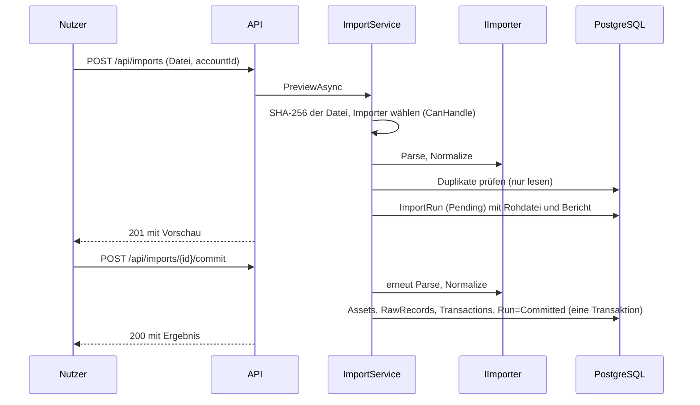

# 04 – Importe

Stand: P4 (Import-Framework). Konkrete Importer für Bitget und Trade Republic folgen; bis dahin gibt es
das allgemeine CSV-Format `generic-csv` als Referenz.

Code: `Application/Imports` (Schnittstelle, Ablauf, Ports), `Importers/` (ein Ordner je Quelle, `Common/` für
gemeinsame Bausteine), `Infrastructure/Persistence/EfImportStore.cs`, `Api/Endpoints/ImportEndpoints.cs`.

## Ablauf eines Importlaufs



1. **Roh speichern:** Die Datei wird unverändert im `ImportRun` abgelegt (SHA-256). Vorschau schreibt sonst nichts.
2. **Parsen und normalisieren:** `Parse` liefert `RawRecord`s, `Normalize` daraus `Transaction`s. Neue Assets
   werden nur im Speicher angelegt (`AssetCatalog`) und erst beim Festschreiben gespeichert.
3. **Duplikate verwerfen:** über `(Quelle, externe ID)`, ohne externe ID über den Inhalts-Hash der Zeile. Auch
   doppelte Zeilen innerhalb einer Datei zählen als Duplikat. Die Datenbank sichert das zusätzlich über Unique-Indizes ab.
4. **Vorschau:** Der Importbericht zeigt, was passieren würde.
5. **Bestätigen:** Beim Commit wird neu analysiert (andere Läufe könnten dazwischen festgeschrieben haben) und
   dann in einer Transaktion geschrieben.
6. **Löschen:** nur unbestätigte Läufe. Bestätigte Läufe und ihre Rohdaten bleiben ([ADR 0002](adr/0002-rohdaten-unveraenderlich.md)).

## Importbericht

| Feld | Bedeutung |
|---|---|
| `rowsRead` | gelesene Datenzeilen (ohne Kopfzeile) |
| `new` | neue Buchungen |
| `duplicates` | bereits importierte oder doppelte Zeilen |
| `needsReview` | Buchungen mit Status `NeedsReview` |
| `errors` | `lineNumber` und `reason` je fehlerhafter Zeile; diese Zeilen werden nicht geschrieben |
| `unknownTypes` | unbekannte Transaktionstypen der Quelle |

**Unbekannte Typen werden nie stillschweigend verworfen:** Sie werden als `Transaction` mit
`Type = Unknown`, `Status = NeedsReview` und Hinweis im `Note` gespeichert und landen in der Review-Queue.

## API

| Endpunkt | Zweck |
|---|---|
| `POST /api/accounts`, `GET /api/accounts` | Konten anlegen/auflisten (Importe brauchen ein Konto) |
| `POST /api/imports` | Multipart: `file`, `accountId`, optional `source`; liefert die Vorschau (201) |
| `GET /api/imports/{id}` | Bericht eines Laufs |
| `POST /api/imports/{id}/commit` | festschreiben (409, wenn schon bestätigt) |
| `DELETE /api/imports/{id}` | nur unbestätigte Läufe (409 sonst, 204 bei Erfolg) |

Fehler: 400 (leere/unbekannte Datei, unbekannte Quelle), 404 (Lauf oder Konto fehlt), 409 (Zustand passt nicht).
Das Upload-Limit ist das Kestrel-Standardlimit (ca. 30 MB).

## Format `generic-csv`

```csv
id,timestamp,type,asset,amount,counter_asset,counter_amount,fee_asset,fee
t-2,2026-01-11T10:00:00+01:00,buy,BTC,0.05,EUR,2500,EUR,2.5
```

- Komma oder Semikolon (aus der Kopfzeile erkannt), Anführungszeichen nach RFC 4180, UTF-8 mit/ohne BOM.
- `timestamp`: ISO 8601; ohne Zeitzone gilt UTC, mit Offset wird nach UTC umgerechnet.
- Zahlen mit Punkt als Dezimaltrenner. `id` ist optional (ohne `id` gilt der Inhalts-Hash der Zeile).
- `type`: Name aus `TransactionType` (Groß-/Kleinschreibung egal, Unterstriche erlaubt, z. B. `transfer_out`).
- Buy, Sell, Trade: `asset/amount` = Erhaltenes, `counter_asset/counter_amount` = Gegebenes.
- Futures-Typen: Vorzeichen von `amount` bestimmt die Richtung (Gewinn = In, Verlust = Out).
- Gebühr: `fee` und `fee_asset` (immer ausgehend).

Beispieldateien: `tests/fixtures/generic-csv/`.

## Wie füge ich einen neuen Broker hinzu?

1. **Fixture anlegen:** echte (anonymisierte) Beispieldatei unter `tests/fixtures/<quelle>/`, auch mit Sonderfällen
   (unbekannter Typ, kaputte Zeile, Duplikat).
2. **Tests zuerst:** in `tests/Importers.Tests` ein Test, der die Datei über `ImportService` mit `InMemoryImportStore`
   einliest und erwartete Buchungen, Fehlerzeilen und `NeedsReview`-Fälle prüft.
3. **Importer schreiben:** Ordner `src/backend/Importers/<Quelle>/` mit einer Klasse, die `IImporter` implementiert:
   - `Source`: eindeutiger Name (z. B. `bitget-csv`).
   - `CanHandle`: erkennt die Datei an Kopfzeile/Struktur, ohne Seiteneffekte.
   - `Parse`: liefert je Datenzeile ein `RawRecord` mit `Payload` (Originaltext), `ContentHash`
     (`IdempotencyKey.Sha256Hex(payload)`), `ExternalId` (falls die Quelle eine liefert), `LineNumber`,
     `FileHash`, `ImportRunId`, `ImportedAtUtc` aus dem `ImportContext`. Unlesbare Zeilen mit
     `context.AddError(zeile, grund)` melden, `context.RowsRead` hochzählen.
   - `Normalize`: baut aus dem `RawRecord` die `Transaction`(s). Assets über `context.Assets.Resolve(symbol)`.
     Jede Buchung muss `Transaction.Validate()` bestehen (siehe [03-datenmodell.md](03-datenmodell.md)).
     Nicht normalisierbar: `ImportRowException` mit lesbarem Grund. Unbekannter Typ: `Type = Unknown`,
     `Status = NeedsReview`, `context.AddUnknownType(name)`.
   - Hat die Quelle mehrere Buchungen je Zeile, müssen `ExternalId`/`ContentHash` je Buchung eindeutig sein.
4. **Registrieren:** eine Zeile in `ImportersAssembly.AddImporters` (`services.AddSingleton<IImporter, ...>()`).
5. **Zeitstempel in UTC**, Mengen als `decimal`, Rundung erst im Report; Fehlendes (Kurs, Kosten) nie als 0 annehmen.
6. `docs/04-importe.md` (Format der Quelle) und `CHANGELOG.md` ergänzen.

Die Abhängigkeitsregeln prüft der Architekturtest: `Importers` kennt weder `Infrastructure` noch `Api` noch `TaxEngine`.
